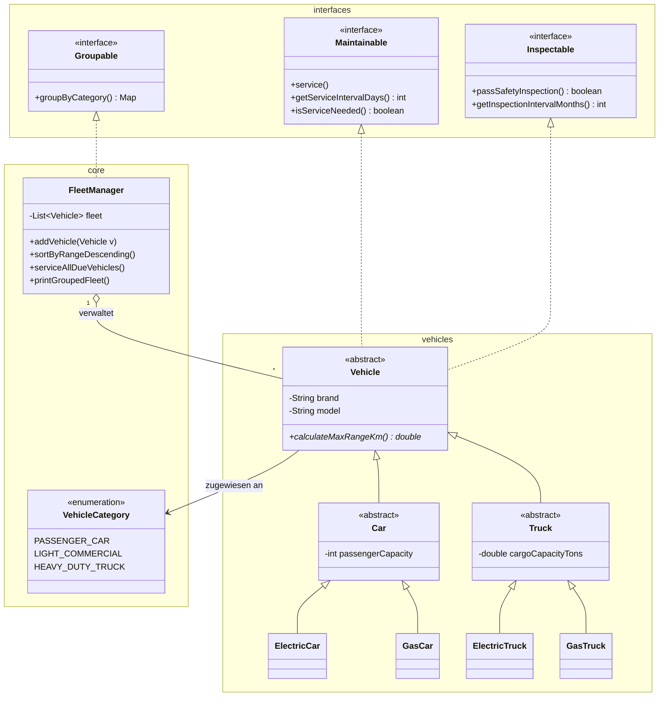

# Fleet Management

## Architektur-Übersicht

- **Hauptsteuerung (`Main` & `FleetManager`)**
- `Main`: Anwendungsstarter, der Testdaten erstellt und Befehle ausführt.
- `FleetManager`: Zentrale Verwaltungseinheit. Speichert die Fahrzeugliste, sortiert Einträge, führt fleet-weite Wartungen aus und setzt `Groupable` um.

- **Schnittstellen & Verträge (`Interfaces`)**
- `Maintainable`: Stellt Methoden für Wartungsaktionen und Service-Intervalle bereit.
- `Inspectable`: Prüft die technische Sicherheit und Inspektionstermine.
- `Groupable`: Vertrag für das Gruppieren von Fahrzeugen nach ihrer Kategorie.

- **Fahrzeugmodell (`VehicleCategory` & `vehicles`)**
- `VehicleCategory`: Enum zur Einstufung der Fahrzeuge (`PASSENGER_CAR`, `LIGHT_COMMERCIAL`, `HEAVY_DUTY_TRUCK`).
- `Vehicle`: Abstrakte Basisklasse, die `Maintainable` und `Inspectable` implementiert.
- `Car` & `Truck`: Abstrakte Zwischenklassen mit spezifischen Merkmalen (Sitzplätze bzw. Ladekapazität).
- `ElectricCar`, `GasCar`, `ElectricTruck`, `GasTruck`: Konkrete Klassen mit der eigentlichen Logik für Antrieb, Reichweite und Wartung.

## Klassendiagramm

